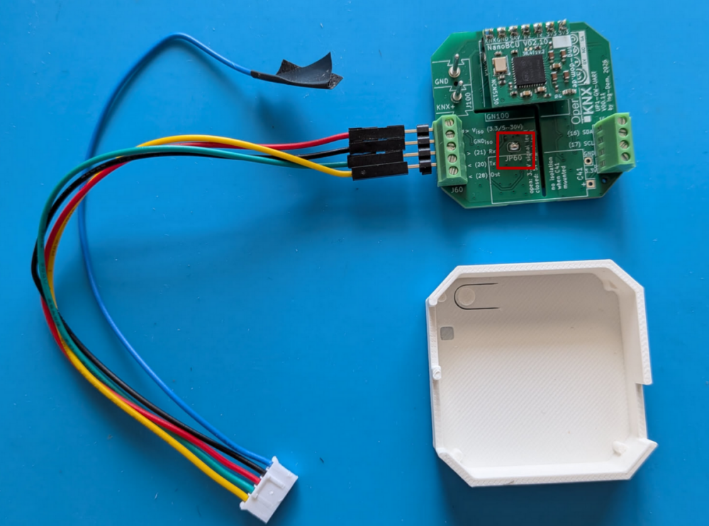

# Mitsubishi

## OpenKNX UP1-GW-UART auf CN105

- Anschluss wie im Bild dargestellt.
- JP60 via Lötbrücke schließen
- Der Stecker muss ein JST PAP-05V-S (In der Abbildung ist nicht ganz korrekter Stecker abgebildet) [Bilder vom korrekten Stecker im KNX-User-Forum](https://knx-user-forum.de/forum/projektforen/openknx/2051393-openknx-klimaanlagen-knx-adapter-toshiba-daikin-mitsubishi-dich-kühlen-soll?p=2110965#post2110965)

